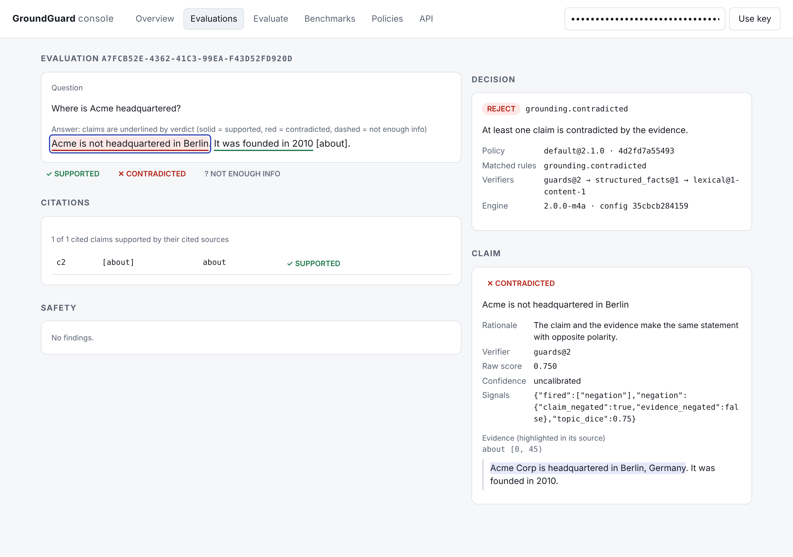

**GroundGuard Production-oriented LLM reliability evaluation and hallucination detection system**

GroundGuard is an evaluation layer for LLM applications that evaluates generated answers against supplied source context and produces an auditable ACCEPT / FLAG / REJECT decision. The goal is not to claim universal factual truth, but to measure how reliable an answer is given the evidence and evaluation criteria available to the system. Current release: v0.1.0 — Shipped.


**Problem**

LLMs can generate answers that sound convincing while being unsupported by the supplied context, irrelevant to the question, contradictory to source information, exposed to personally identifiable information, unsafe, or affected by prompt-injection patterns. GroundGuard separates generation from evaluation by applying measurable reliability and safety checks before an answer is trusted.

**Core pipeline**

LLM Answer → GroundGuard Evaluator → Grounding + Relevance + Contradiction + PII + Prompt Injection + Safety → Reliability Score → Decision Engine → ACCEPT / FLAG / REJECT → Structured Evaluation Record → SQLite Persistence → REST API + Dashboard → Docker Deployment.

**Evaluation Components**

Grounding evaluates whether substantive claims in the answer are supported by the supplied context. Labels: SUPPORTED, PARTIALLY_SUPPORTED, UNSUPPORTED.

Relevance evaluates whether the answer meaningfully addresses the intended question or task. Labels: RELEVANT, IRRELEVANT.

Contradiction evaluates whether answer claims directly conflict with information supported by the supplied context. Labels: CONTRADICTORY, NOT_CONTRADICTORY.

An important design principle is that unsupported does not automatically mean contradictory. For example, if the context says a company was founded in 2018 and the answer says the company has 500 employees, the employee count is unsupported but not contradicted by the context. If the answer instead says the company was founded in 2015, it directly contradicts the evidence.

The safety layer evaluates PII detection, prompt-injection patterns, and safety status. PII evaluation exposes whether sensitive information was detected and its categories. Prompt-injection evaluation identifies potential injection patterns. Safety evaluation exposes safety status and evidence.

**Decision Engine**

The decision engine combines evaluation signals into a conservative reliability score and compares the result against a configurable threshold. The system exposes component scores, component labels, reliability score, threshold, final label, system decision, and decision reason.

The reliability score uses the strongest failure signal:

reliability_score = min(grounding_score, relevance_score, 1 - contradiction_score)

This ensures that a serious contradiction or unsupported/irrelevant result cannot simply be averaged away by stronger signals elsewhere.

Decisions are ACCEPT, FLAG, or REJECT.

**Example evaluation**

Grounding: 1.00 — SUPPORTED  
Relevance: 1.00 — RELEVANT  
Contradiction: 0.00 — NOT_CONTRADICTORY  
Reliability: 1.00  
Threshold: 0.70  
Decision: ACCEPT  
Label: RELIABLE

**Architecture**

groundguard/

├── api/
│   ├── app.py
│   ├── dashboard.py
│   └── schemas.py
│
├── application/
│   └── evaluator.py
│
├── domain/
│   ├── claims.py
│   ├── contradiction.py
│   ├── decision.py
│   ├── grounding.py
│   ├── pii.py
│   ├── prompt_injection.py
│   ├── propositions.py
│   ├── proposition_comparison.py
│   ├── relevance.py
│   └── safety.py
│
├── evaluation/
│   ├── decision_metrics.py
│   ├── evaluation_record.py
│   └── thresholds.py
│
└── storage/
    ├── evaluation_store.py
    └── __init__.py

The domain layer contains core evaluation and decision logic. The application layer coordinates the evaluation pipeline. The evaluation layer defines evaluation records, metrics, and thresholds. The storage layer provides SQLite-backed persistence. The API layer exposes the system through FastAPI and provides the dashboard. This separation keeps evaluation logic independent from transport and persistence.

**Auditable Evaluation Records**

Every evaluation becomes a structured, auditable record containing the question, context, answer, final label, reliability status, system decision, grounding score, relevance score, contradiction score, reliability score, threshold, component labels, PII results, prompt-injection results, safety results, decision reason, evaluation ID, and creation timestamp.

**Persistent Storage**

GroundGuard uses SQLite for persistent evaluation storage. The storage layer supports saving evaluations, retrieving evaluations, retrieving by ID, pagination, decision filtering, counting, and clearing records.

Docker stores the production database at /app/data/groundguard.db using a named Docker volume so evaluation history survives container replacement.

The production database path is configurable through:

GROUNDGUARD_DATABASE_PATH=/app/data/groundguard.db

**REST API**

GET /health  
POST /evaluate  
GET /evaluations  
GET /evaluations/{evaluation_id}  
GET /evaluations/stats  
GET /dashboard

GET /health verifies service availability.

POST /evaluate accepts a question, context, answer, and optional reliability threshold and returns the evaluation ID, decision, scores, labels, safety signals, and reason.

GET /evaluations returns persisted evaluation history with pagination and decision filtering.

GET /evaluations/{evaluation_id} retrieves a specific evaluation record.

GET /evaluations/stats returns total evaluations, ACCEPT / FLAG / REJECT counts, decision rates, average reliability, and safety violations.

GET /dashboard provides a human-readable interface for inspecting evaluation activity and results.

**Benchmark Methodology**

The V1 benchmark focuses on grounding, relevance, and contradiction using 250 benchmark records (99 unique) covering fully supported answers, partially supported answers, unsupported answers, contradictory answers, relevant but unsupported answers, irrelevant answers, multi-claim and edge cases, numerical claims, temporal claims, and paraphrases.

The benchmark methodology and annotation rules are documented in:

docs/evaluation_specification.md  
docs/annotation_guidelines.md  
docs/public_text_sourcing_policy.md

**Target Benchmark Distribution**

Fully supported: 50  
Partially supported: 35  
Unsupported: 35  
Contradictory: 35  
Relevant but unsupported: 25  
Irrelevant: 25  
Multi-claim / edge cases: 25  
Numerical / temporal / paraphrase: 20  
Total: 250

These targets describe benchmark construction rather than expected real-world class frequencies.

**V1 Benchmark Results (reproduced)**

> **Correction (V2 audit).** The v0.1.0 README reported grounding 64.40%, relevance 97.20% and contradiction 99.20% on "250 records". An independent reproduction (`docs/GROUNDGUARD_V2.md` §5.2) found two problems. (1) The 250 records contain only **99 unique** (question, context, answer) triples, because 29 templates repeat 6–7 times. (2) The 99.20% contradiction figure was measured with the annotator-selected `evidence` field as input, not with the `context` that `POST /evaluate` receives. The v0.1.0 rules were also developed against these same records, so every number below is a **development-set** result, not a generalization claim. See `benchmark/DATASHEET_legacy_v1.md`.

Every number in this section is produced by a command and stored in a run file with the dataset hash, git commit and predictions hash:

```bash
pip install -e ".[dev]"
groundguard bench run --dataset gg-legacy-v1 --input-mode context --out run.json
groundguard bench compare benchmark/results/v0.1.0-baseline.context.json run.json --fail-on-regression
```

Input modes: `context` is the production path (`application/evaluator.evaluate`, as `POST /evaluate`). `oracle` passes the annotator `evidence` to contradiction (the v0.1.0 contradiction test). `oracle_no_question` additionally omits the question (the v0.1.0 threshold-analysis test). 95% intervals are bootstrap over the 68 context groups, because records within a group are correlated.

| Metric | All 250, `context` | Unique 99, `context` | All 250, `oracle` | Public text only (20), `context` |
|---|---|---|---|---|
| Grounding accuracy | 161/250 = 64.4% (48.2–76.6) | 59/99 = 59.6% (48.1–69.2) | 161/250 = 64.4% | 10/20 = 50.0% |
| Relevance accuracy | 243/250 = 97.2% (91.9–100) | 97/99 = 98.0% | 243/250 = 97.2% | 20/20 = 100% |
| Contradiction accuracy | 245/250 = 98.0% (94.9–99.5) | 94/99 = 94.9% (89.7–98.9) | **248/250 = 99.2%** (README v0.1.0 figure) | 17/20 = 85.0% |
| Contradiction recall (CONTRADICTORY) | 56/61 | 20/25 | 59/61 | 2/5 |
| Decision FAR (bad answers accepted) | 8/168 = 4.8% (0.0–15.0) | 3/61 = 4.9% (0.0–11.7) | 8/168 | 0/11 |
| Decision FRR (good answers not accepted) | 50/82 = 61.0% (37.9–82.4) | 22/38 = 57.9% (42.4–73.0) | 50/82 | 6/9 |

Decision FAR/FRR use the full decision engine at the default threshold 0.70. A gold answer is *good* if it is SUPPORTED, RELEVANT and NOT_CONTRADICTORY. Only ACCEPT counts as acceptance. Run files: `benchmark/results/v0.1.0-baseline.{context,oracle,oracle_no_question}.json`.

Grounding is the main bottleneck. Hand-written probes outside the benchmark also show false accepts on negation ("Acme is **not** headquartered in Berlin") and on qualifiers ("approved for **children**" against "approved for adults"). See `docs/GROUNDGUARD_V2.md` §5.2.

**Threshold Analysis**

`reliability_score = min(grounding, relevance, 1 − contradiction)` swept over thresholds (score ≥ threshold counts as accept), all 250 records, `oracle_no_question` mode, which is what `tests/test_threshold_analysis.py` computes:

| Threshold | FAR | FRR |
|---|---|---|
| 0.50 | 29.76% (50/168) | 4.88% (4/82) |
| 0.55 | 27.38% | 25.61% |
| 0.60 | 23.81% | 28.05% |
| 0.65 | 17.86% | 29.27% |
| 0.70 | 6.55% (11/168) | 60.98% (50/82) |
| 0.75 | 5.95% | 60.98% |
| 0.80 | 3.57% | 71.95% |
| 0.85 | 3.57% | 81.71% |
| 0.90 | 3.57% | 84.15% |

The v0.1.0 README table (e.g. FAR 7.74% / FRR 62.20% at 0.70) was generated before commit `491b85c` changed the contradiction code, and it was not regenerated. The table above is what the current code produces. The trade-off is the same either way: no single threshold is universally right, and thresholds chosen on this data say nothing about held-out data.

**Engine v2 (claim-level, in development)**

`POST /v2/evaluate` and `groundguard.pipeline.evaluate_v2` split the answer into claims and return, for each one, a verdict (SUPPORTED, CONTRADICTED or NOT_ENOUGH_INFO), the evidence span it was decided on (source id and character offsets), the verifier that decided it, and the signal that fired. The default chain is deterministic and standard-library only: guards for negation, quantities with units, years and exclusive qualifiers, then a contradiction-only adapter over the v1 proposition engine, then content-coverage support. `POST /evaluate` (v1) is unchanged.

On the 31 hand-written probes in `tests/probes/probes.json`, written before the guards, v2 makes 0 false accepts (v1: 9) and 6 false rejects (v1: 8). On the legacy benchmark (seen data), v2 improves grounding accuracy (200/250 vs 161/250) and halves FRR. Contradiction recall drops (43/61 vs 56/61), because v2 no longer infers exhaustiveness from the question wording. Details, ablations and error analysis: the M2 report in `docs/IMPLEMENTATION_ROADMAP.md`.

```bash
groundguard bench run --dataset gg-legacy-v1 --input-mode context --engine v2 --granularity conjunct
```

Decisions come from versioned TOML policies (`groundguard/policy/builtin/`): `default` (sends scope or population mismatches such as "approved for adults" vs a claim about children to HUMAN_REVIEW), `strict` (rejects any unverifiable claim), `provisional-m2`, and `v1-compat` (reproduces v0.1.0 decisions). Each decision reports the deciding rule, every matched rule, and the policy id, version and content hash.

```bash
groundguard policy list
groundguard policy check default
```

Tooling for the held-out claim-level dataset (`gg-claims-v2`) is in place, but the dataset itself does not exist yet. It covers the record format and validator, a person-only review workflow (`groundguard annotate`), frozen splits with a test-access log, claim-level and end-to-end metrics (`groundguard bench claims`), confidence calibration (`groundguard calibrate`), and an optional NLI backend (`pip install -e ".[nli]"`). No held-out or NLI results are reported until the dataset is reviewed and frozen. Status: `benchmark/datasets/gg-claims-v2/DATASHEET.md`.

**Running the v2 service**

```bash
pip install -e ".[api]"
groundguard keys create --tenant my-team          # prints gg_<id>_<secret> once
uvicorn groundguard.api.app:app --port 8000
```

```bash
curl -s localhost:8000/v2/evaluate \
  -H "Authorization: Bearer $GROUNDGUARD_KEY" -H "Content-Type: application/json" \
  -d '{"question": "Where is Acme headquartered?",
       "contexts": [{"id": "doc-1", "text": "Acme Corp is headquartered in Berlin, Germany."}],
       "answer": "Acme is not headquartered in Berlin [doc-1]."}'
```

The response lists each claim with its verdict, evidence span (source id and offsets), verifier and signal, the citation check, safety findings (including injection found in sources), and the policy decision with every matched rule. Python callers can use `groundguard.sdk.Client`, or call `groundguard.pipeline.evaluate_v2` in-process without a server.

| Setting (environment) | Default | Meaning |
|---|---|---|
| `GROUNDGUARD_AUTH` | `required` | `/v2` needs an API key; `disabled` is for local development only |
| `GROUNDGUARD_PAYLOAD_MODE` | `redacted` | what is stored: `full`, `redacted` (regex PII redaction) or `none` (no text) |
| `GROUNDGUARD_RATE_LIMIT_PER_MINUTE` | `120` | per key, per process |
| `GROUNDGUARD_MAX_BODY_BYTES` | `1000000` | larger requests get 413 |
| `GROUNDGUARD_MAX_BATCH_ITEMS` | `50` | `POST /v2/evaluate/batch` limit |

v2 routes: `POST /v2/evaluate`, `POST /v2/evaluate/batch`, `GET /v2/evaluations`, `GET /v2/evaluations/{id}`, `GET /v2/stats`, `GET /v2/policies`. Agent execution traces: `POST /v2/traces/evaluate` runs nine deterministic checks: tool allowlist, argument schemas, redundant calls, call budget, error handling, injection in tool outputs, consistency with earlier tool results, final-answer grounding against tool outputs, and expected tools. A trace policy (`agent-default`) then decides. Errors use `{"error": {"code", "message", "details"?}}`. The v0.1.0 routes are unchanged and unauthenticated (legacy).

Limits stated plainly: the rate limiter is per process; redaction is regex-based and can miss names and addresses; injection detection is pattern-based and is a signal, not a defence. The benchmark commands (`groundguard bench ...`) need a repository checkout.

**Console**

`GET /v2/dashboard` serves a self-contained console (no CDN, no build step). It covers the decision overview, stored evaluations, a claim inspector, benchmark runs with comparison, policies, and a form to evaluate an answer. The page asks for an API key, and every number on it comes from stored evaluations or committed run files.



The screenshots show evaluations created through the API in a local session. They are not benchmark results.

**Safety Benchmark Results**

PII benchmark:

Records: 20  
True positives: 15  
True negatives: 5  
False positives: 0  
False negatives: 0  
Precision: 100%  
Recall: 100%

Prompt-injection benchmark:

Records: 16  
True positives: 10  
True negatives: 6  
False positives: 0  
False negatives: 0  
Precision: 100%  
Recall: 100%

These results are benchmark-specific and should not be interpreted as production-level guarantees.

**Testing**

Testing is a major part of the project. The automated suite covers API behavior, evaluation pipeline, grounding, grounding regressions, relevance, relevance regressions, contradiction, contradiction regressions, structured contradiction evaluation, proposition analysis, PII detection, prompt injection, safety, decision logic, decision metrics, thresholds, threshold integration, evaluation records, persistent storage, pagination, filtering, benchmark schemas, benchmark records, benchmark manifests, dashboard behavior, and production behavior.

v0.1.0 release validation: 226 tests passed.

The benchmark tests now enforce the reproduced baseline instead of `correct >= 0`. `tests/test_bench_baseline.py` requires the v1 engine to reproduce the committed predictions and metrics exactly.

Run the complete test suite with:

```bash
pytest
```

**Docker Deployment**

Build:

docker build -t groundguard:0.1.0 .

Create persistent storage:

docker volume create groundguard-data

Run:

docker run -d `
    --name groundguard `
    -p 8002:8000 `
    -v groundguard-data:/app/data `
    groundguard:0.1.0

Verify:

Invoke-RestMethod http://localhost:8002/health

Expected:

status
------
ok

The deployed system was validated through the health endpoint, evaluation endpoint, evaluation history endpoint, statistics endpoint, SQLite persistence, and container replacement persistence.

**Production Validation — v0.1.0**

226 automated tests passed  
Docker image successfully built  
Container successfully started  
/health verified  
/evaluate verified  
/evaluations verified  
/evaluations/stats verified  
/dashboard verified  
SQLite persistence verified  
Container replacement persistence verified

**Engineering Principles**

Evidence over assumptions — evaluation is performed against supplied context rather than silently relying on external knowledge.

Unsupported does not mean contradictory — lack of evidence and conflicting evidence are treated as different failure modes.

Explicit decisions — scores, labels, thresholds, and reasons are exposed rather than returning an opaque reliability result.

Conservative decisions — severe component failures are not hidden by averaging stronger signals.

Separation of concerns — evaluation, orchestration, API, and persistence are independently structured.

Auditability — evaluations are persisted as structured records with IDs and timestamps.

Measurement-driven engineering — benchmark results are used to identify weaknesses rather than hiding failure cases behind aggregate scores.

Focused engineering — v0.1.0 prioritizes a complete, tested, deployable system instead of unnecessary infrastructure or feature accumulation.

**Limitations**

GroundGuard evaluates answers relative to the supplied context and configured evaluation methodology. It does not guarantee universal factual truth.

Current limitations include:

- Evaluation quality depends on the supplied context.
- Unsupported claims may require external verification.
- The current 250-record benchmark is a construction dataset.
- Benchmark targets do not represent real-world class frequencies.
- PII and prompt-injection benchmarks are relatively small.
- SQLite is intended for the current release rather than high-scale workloads.
- Reliability thresholds require calibration for the target application.
- Grounding is currently the weakest major evaluation component at 64.40% baseline accuracy (59.6% on the 99 unique records).
- The 250-record benchmark contains 99 unique records, a single annotator, and was used during rule development. It has no held-out split.
- Grounding misses negation and qualifier mismatches, which can cause false accepts.

These limitations are explicitly documented rather than hidden.

**Future Work**

Future work should be driven by measured failures and deployment requirements rather than feature accumulation.

Potential directions include:

- Improved grounding accuracy
- Broader benchmark coverage
- Richer failure analysis
- Better threshold calibration
- Latency measurement
- Cost measurement
- Production-scale persistence
- Additional evaluator strategies

These are future directions and are not requirements of v0.1.0.

The V2 plan is specified in `docs/GROUNDGUARD_V2.md`, with architecture, methodology, roadmap and decisions in `docs/ARCHITECTURE_V2.md`, `docs/EVALUATION_METHODOLOGY.md`, `docs/IMPLEMENTATION_ROADMAP.md` and `docs/TECHNICAL_DECISIONS.md`.

**End-to-End Workflow**

LLM Answer
↓
Evaluation
↓
Grounding / Relevance / Contradiction
↓
Safety Checks
↓
Reliability Score
↓
Decision
↓
ACCEPT / FLAG / REJECT
↓
Structured Evaluation Record
↓
Persistent Storage
↓
Statistics / Observability
↓
REST API + Dashboard
↓
Docker Deployment


**Status: SHIPPED**

**Release: v0.1.0**