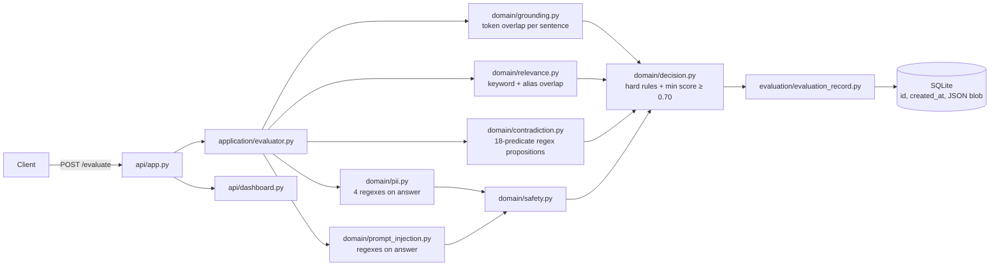
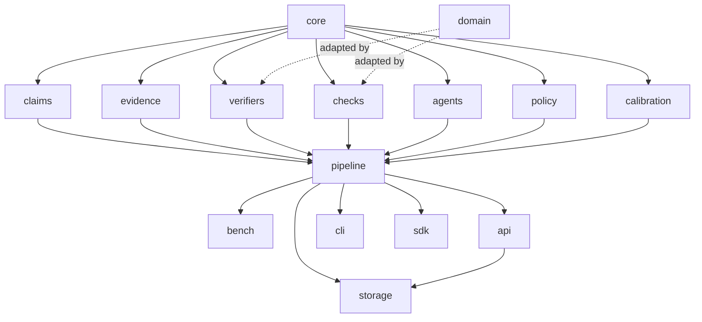
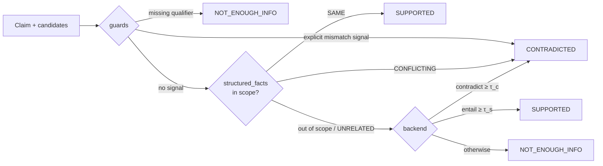
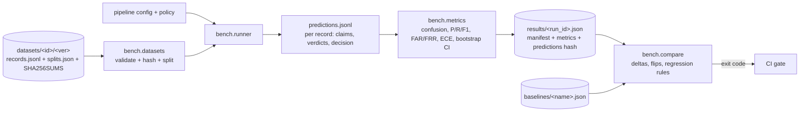
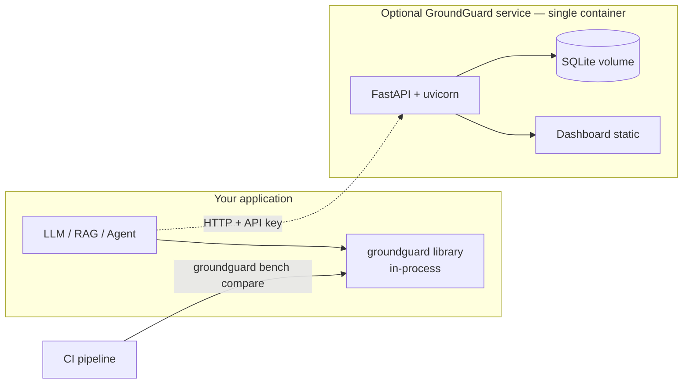

# GroundGuard V2 — Architecture

**Status:** DRAFT, proposed. Describes the target design. Sections marked
*(v0.1.0)* describe what exists today.

## 1. Constraints that shape the design

1. **Deterministic by default.** The default verifier chain uses only the
   standard library, so a benchmark run is reproducible bit-for-bit.
2. **The library comes before the service.** Every capability is callable
   in-process. The HTTP API is a thin adapter.
3. **No silent semantic change.** v0.1.0 behavior stays reachable
   (`engine="v1"`) and is pinned by an equivalence test.
4. **Optional weight.** Model-backed verifiers (NLI, LLM judge) are extras and
   are never imported by the core.
5. **Single node.** SQLite by default. No queues, workers, or microservices
   until a measured requirement exists (ADR-009).

## 2. Current architecture *(v0.1.0)*



Known structural issues: the store is created at import time; `/stats` loads
all rows; there is no evaluator/config version per record; injection checks
skip the context.

## 3. Target package layout

```
groundguard/
├── __init__.py            public API: evaluate(), evaluate_trace(), load_policy(), __version__
├── core/
│   ├── types.py           SourceDocument, Claim, Span, EvidenceSpan, ClaimVerdict, CheckResult,
│   │                      Finding, RuleFiring, DecisionResult, EvaluationReport, EvaluatorManifest
│   ├── errors.py          GroundGuardError → InvalidInput, PolicyError, VerifierUnavailable, DatasetError
│   └── serialization.py   to_dict / from_dict, canonical JSON, config hashing
├── claims/
│   ├── segmenter.py       sentence → clause → conjunct; offsets preserved
│   └── assertiveness.py   tags questions / hedges / meta-text as non-assertive
├── evidence/
│   ├── chunking.py        sentence windows with source_id + offsets
│   └── bm25.py            pure-Python BM25 + numeric/entity overlap boost
├── verifiers/
│   ├── base.py            Verifier protocol, VerifierChain
│   ├── guards.py          negation, number/unit, date, qualifier/scope mismatch
│   ├── lexical.py         adapter over v1 token-overlap scoring (unchanged semantics)
│   ├── structured_facts.py adapter over v1 propositions (declared predicate scope; abstains otherwise)
│   ├── nli.py             [extra: nli] local entailment cross-encoder
│   └── llm_judge.py       [extra: llm] versioned prompt, JSON output, quote-must-match guard
├── checks/
│   ├── relevance.py       adapter over v1 relevance (+ optional backends later)
│   ├── pii.py             v1 regexes + Luhn / IBAN validators + span offsets
│   ├── injection.py       v1 patterns applied to answer AND every SourceDocument
│   ├── citations.py       citation parsing + per-citation verification
│   └── rag_metrics.py     faithfulness, utilization, reference-based precision/recall
├── agents/
│   ├── trace.py           Trace, Step, ToolCall, ToolSpec
│   ├── schema_validate.py JSON-Schema subset validator (type/required/enum/min/max/pattern/items)
│   └── checks.py          allowlist, argument validity, redundancy, error recovery, state consistency
├── policy/
│   ├── model.py           Policy, Rule, Condition (closed set of condition kinds)
│   ├── loader.py          TOML via stdlib tomllib; strict validation; version + hash
│   ├── engine.py          ordered rule evaluation → DecisionResult with fired_rules
│   └── builtin/           v1_compat.toml, default_v2.toml, strict.toml
├── pipeline.py            orchestrates: segment → select evidence → verify → checks → policy
├── calibration/
│   ├── isotonic.py        pool-adjacent-violators, pure Python
│   └── platt.py           logistic fit by Newton iterations, pure Python
├── bench/
│   ├── datasets.py        registry, schema validation, sha256, dedup view, group splits
│   ├── runner.py          runs a pipeline config over a split → predictions
│   ├── metrics.py         confusion, P/R/F1, FAR/FRR, ECE, bootstrap CI, threshold sweep
│   ├── manifest.py        git SHA, dirty flag, env, hashes, timings
│   └── compare.py         metric deltas with CIs, per-record flips, regression rules
├── domain/                v0.1.0 modules, unchanged (the v1 engine)
├── application/           v0.1.0 evaluator, unchanged
├── evaluation/            v0.1.0 records / metrics, unchanged
├── storage/
│   ├── migrations/        0001_v1.sql, 0002_v2_columns.sql, …
│   └── store.py           schema-versioned SQLite; indexed columns; tenant scoping; SQL aggregation
├── api/
│   ├── app.py             app factory + lifespan; mounts v1 (unchanged) and v2 routers
│   ├── v1.py              current routes, byte-compatible
│   ├── v2.py              new routes
│   ├── auth.py            API keys (hashed), tenant resolution
│   ├── limits.py          token-bucket rate limiter, payload caps
│   └── dashboard/         static HTML/CSS/JS, no CDN
├── sdk/client.py          urllib-based client, typed responses, retry/backoff
└── cli.py                 groundguard eval | bench run | bench compare | policy check
```

Dependency rule (enforced by an import-linter-style test in `tests/`):



`core` imports nothing from GroundGuard. `pipeline` imports no transport or
storage code. Nothing imports `api`.

## 4. Request data flow (`POST /v2/evaluate`)

```mermaid
sequenceDiagram
    participant C as Client
    participant A as api/v2
    participant P as pipeline
    participant S as claims.segmenter
    participant E as evidence.bm25
    participant V as VerifierChain
    participant K as checks
    participant Y as policy.engine
    participant D as storage

    C->>A: question, contexts[], answer, citations?, reference?, policy?
    A->>A: auth → tenant; size caps; schema validation
    A->>P: EvaluationRequest
    P->>S: segment(answer)
    S-->>P: Claim[] (offsets, assertive flag)
    loop each assertive claim
        P->>E: top_k(claim, chunks)
        E-->>P: EvidenceSpan[]
        P->>V: verify(claim, candidates)
        Note over V: guards (may veto) → structured_facts (may abstain)<br/>→ backend (lexical | nli | llm_judge)
        V-->>P: ClaimVerdict
    end
    P->>K: relevance, pii(answer), injection(answer + every source), citations, rag_metrics
    K-->>P: CheckResult[]
    P->>Y: verdicts + checks + policy
    Y-->>P: DecisionResult (decision, fired_rules, reason)
    P-->>A: EvaluationReport + EvaluatorManifest
    A->>D: persist (redacted per policy), indexed columns
    A-->>C: 200 EvaluationReport
```

## 5. Verifier chain semantics



Rules:
- A guard may only veto **with a recorded signal** (e.g.
  `{"negation_mismatch": {"claim": "not", "evidence": null}}`). Guards never
  produce SUPPORTED.
- Every verifier returns its `raw_score`. `confidence` is filled only by a
  calibrator fitted for that exact `verifier@version` on a dev split.
- The chain is configuration, recorded in the manifest as an ordered list of
  `name@version`.

## 6. Policy engine

Policies are TOML (stdlib `tomllib`, no new dependency). Rules are evaluated in
order. The first *terminal* rule decides. Non-terminal rules annotate only.
The condition vocabulary is a **closed set** that the loader validates. There
is no `eval` and no expression language.

```toml
[policy]
id = "default"
version = "2.0.0"
description = "Conservative default for customer-facing RAG answers."

[[rule]]
id = "safety.pii"
when = { check_failed = "pii" }
decision = "REJECT"

[[rule]]
id = "safety.indirect_injection"
when = { check_failed = "injection", location = "source" }
decision = "HUMAN_REVIEW"

[[rule]]
id = "grounding.contradiction"
when = { any_claim = "CONTRADICTED" }
decision = "REJECT"

[[rule]]
id = "grounding.low_confidence"
when = { min_claim_confidence_below = 0.6 }     # only fires for calibrated verifiers
decision = "HUMAN_REVIEW"

[[rule]]
id = "grounding.unsupported_fraction"
when = { nei_fraction_above = 0.0 }
decision = "FLAG"

[[rule]]
id = "relevance"
when = { check_failed = "relevance" }
decision = "REJECT"

[default]
decision = "ACCEPT"
```

`policy/builtin/v1_compat.toml` encodes the v0.1.0 decision order (unsafe →
contradictory → unsupported → irrelevant → partial → score < threshold → accept)
using `legacy_*` conditions over v1 component outputs. An equivalence test runs
it over all 250 legacy records and asserts identical `system_decision` and
`reason`.

## 7. Storage

```sql
-- 0002_v2_columns.sql (illustrative)
CREATE TABLE evaluations_v2 (
    id               TEXT PRIMARY KEY,          -- uuid4
    tenant_id        TEXT NOT NULL,
    created_at       TEXT NOT NULL,             -- ISO-8601 UTC with microseconds
    decision         TEXT NOT NULL CHECK (decision IN ('ACCEPT','FLAG','REJECT','HUMAN_REVIEW')),
    policy_id        TEXT NOT NULL,
    policy_version   TEXT NOT NULL,
    engine           TEXT NOT NULL,
    config_hash      TEXT NOT NULL,
    n_claims         INTEGER NOT NULL,
    n_contradicted   INTEGER NOT NULL,
    n_nei            INTEGER NOT NULL,
    safety_findings  INTEGER NOT NULL,
    payload_mode     TEXT NOT NULL CHECK (payload_mode IN ('full','redacted','none')),
    report           TEXT NOT NULL              -- canonical JSON EvaluationReport
);
CREATE INDEX ix_eval_tenant_time     ON evaluations_v2 (tenant_id, created_at DESC);
CREATE INDEX ix_eval_tenant_decision ON evaluations_v2 (tenant_id, decision, created_at DESC);
CREATE TABLE schema_version (version INTEGER NOT NULL);
```

The v1 `evaluations` table is untouched and v1 routes keep using it. Stats are
computed with `GROUP BY` and are never loaded into Python memory.

## 8. Benchmark harness



`run_id = <dataset>@<ver>-<split>-<config_hash[:8]>-<git_sha[:8]>`. Test-split
runs are additionally appended to `benchmarks/results/TEST_ACCESS_LOG.jsonl`
(who, when, why), so every look at held-out data is visible.

## 9. Agent trace evaluation

```mermaid
flowchart TB
    T[Trace: goal, tools: ToolSpec[], steps[], final_answer] --> A1[allowlist + forbidden tools]
    T --> A2[argument validity vs ToolSpec.parameters]
    T --> A3[redundant calls / budget]
    T --> A4[error → recovery pattern]
    T --> A5[state consistency:<br/>LLM-step claims vs earlier tool results]
    T --> A6[final answer grounding:<br/>claim pipeline with tool outputs as sources]
    T -. expected_tools? .-> A7[tool selection vs reference]
    A1 & A2 & A3 & A4 & A5 & A6 & A7 --> PE[policy engine<br/>trace-scoped rules]
    PE --> DR[DecisionResult + per-step findings]
```

A5 and A6 reuse the same claim pipeline, so RAG and agents share one grounding
implementation (the "unified" part of the design).

## 10. Deployment topology



## 11. Cross-cutting concerns

- **Errors:** library functions raise typed `GroundGuardError` subclasses. The
  API maps them to `{"error": {"code", "message", "details"}}` with stable codes.
- **Typing:** new packages are type-checked with `mypy --strict`. v0.1.0
  modules are checked non-strict to avoid churn.
- **Logging:** structured JSON logs (stdlib `logging`) with `evaluation_id`,
  `tenant_id`, latency per stage. Payloads are never logged.
- **Versioning:** SemVer for the package. `policy.version` and
  `verifier@version` are independent. Any change to verifier behavior bumps its
  version, which invalidates its calibrator.
